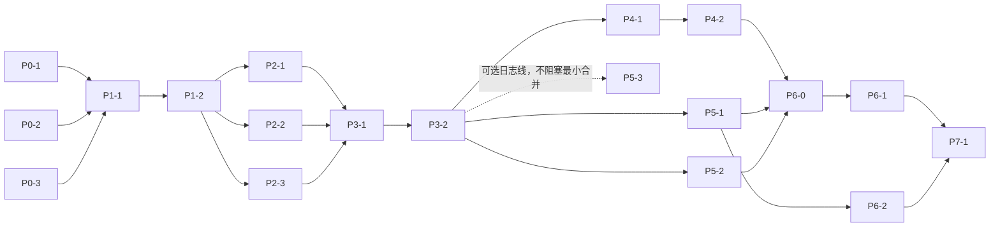

# 把 dsh-mattpocock-skills-deck 合并进 dsh-github-resident：可行性与实施方案评估

> 历史材料：本文的独立回环端口与 `DSH_GH_API_PORT` 方案已退役。当前面板、脚本均走宿主 RPC `/api/dsws` 的 `ghr.*` 端点；此处保留旧测量与决定的原文供追溯，现行清单以 `gh_protocol.http` 为准。

| 项 | 值 |
|---|---|
| 评估日期 | 2026-10-11（UTC）；本次为**文档收敛修订**，未重新采集运行态 |
| 评估对象 | Resident `SunsetRNE/dsh-github-resident`（本地 `1.6.4`，HEAD `54a1a07`）＋ Deck `FeatherHunter/dsh-mattpocock-skills-deck`（本地 `1.8.0-rc.7`，HEAD `3b25cd3f`） |
| 目标 | 以一个插件运行，保留 Deck 的全部工具 / 右侧栏 / 技能 / issue-map / 标签 / 诊断能力，并把 Deck 设置页合并进 Resident 设置页的「仓库登记库」页 |
| 本次性质 | **只评估、只写文档**。未改代码 / manifest / 构建产物 / 运行配置 / 凭据，未安装或启停插件，未执行迁移，未创建或修改 issue，未 commit/push |
| 作者写入范围 | 仅本文件（主报告） |
| 整次交付范围 | 1 份主报告 + 3 份证据底稿，共 4 个 Markdown：本文件、[01-feature-matrix-and-form.md](./merge-deck-evidence/01-feature-matrix-and-form.md)（已完成）、[02-ui-settings-and-slot-conflicts.md](./merge-deck-evidence/02-ui-settings-and-slot-conflicts.md)（已完成）、[03-migration-permission-plan.md](./merge-deck-evidence/03-migration-permission-plan.md)（已完成） |
| 交付状态 | **文档定稿；未实现、未实机功能测试**。无代码 / manifest / 构建产物 / profile / 凭据改动 |

**引用约定**：`plugin.js:806` 指本仓根下的 [plugin.js:806](../plugin.js#L806)，`client.js:427` 指 [client.js:427](../client.js#L427)；前缀 `D:` 指 Deck 检出 `/root/dsh-github-resident/dsh-mattpocock-skills-deck`，如 `D:src/client/panelAssembly.js:91` = [dsh-mattpocock-skills-deck/src/client/panelAssembly.js:91](../../dsh-mattpocock-skills-deck/src/client/panelAssembly.js#L91)；前缀 `H:` 指宿主框架源码。三类事实：`本地源码`（读工作区）、`上游远端`（只读）、`已安装副本/运行清单`（`/root/.dsh` 只读观察 + `host/Tool.listTools`）。**「清单里可见」≠「调用成功」**。

---

## 0. 结论先给

### 0.1 可行性判断

**可行，但这是「重构级合并」，不是「改 manifest 级合并」。** 阻力只有三处：① 身份（包名 / 客户端模块 id / 技能发现路径 / 更新 id）必须一次性定死；② Resident 是零构建单文件、Deck 是多文件 + `lib/` 构建产物 + 327 个 `verify-*` 门禁，两套体系必须并存；③ 两条更新链（插件包 vs gh 二进制）与两套落盘父目录都要显式命名。

工具面几乎零冲突：`gh_*` 17 个与 `deck_*` 10 个（9 个业务工具 + `deck_probe`）名字无交集，运行清单里两个集合交集为空（§2）。

### 0.2 推荐方案：形态 B（单 Resident 包 + 统一 Client factory + Host 内部模块装配）

1. **一个 npm 包、一个 profile bundle**：一份 `package.json`、一份 `cordis.patch.yml`、一份 `files` 白名单、一套版本号。
2. **客户端只能有一个** `window.__ModuleLoader__.load({ id: 合并包名 })`：Deck 半边作为同一 factory 内的 `apply` 被顺序调用（构建期合成），保留 Deck 自建的 `host/styles/timer` shim。这是宿主契约决定的硬约束（§3.1）。
3. **宿主不强制单 Host 入口（推荐 B）**：Resident 的入口 `import` Deck 的模块化宿主代码并调用其 `apply(ctx)`；同包多行（A′）也是合法形态，差别只在实例数与装配面——**单入口不等于单文件**；Deck 的 `src/**` 分层、`lib/**` 构建产物、`bundled-skills/`、`tests/` 原样保留为内部模块。327 个门禁中，**纯内部行为与文件布局类断言可复用**；**身份、patch/装配形状、客户端入口类断言仍需随合并形态更新**，不能整体写成「零冲击」。
4. **`/tools` 行去留列为运行态待验证项**：现状 Deck 的 9 个工具由 `deckToolsRow.js`（行模块）与 `wiring.js → hookDeckAgentTools`（宿主钩子）两条通路注册，分处不同 Host/Agent 作用域；两条都把 `register` 包在 `try/catch` 里，失败会被吞，**无法据此判断哪条通路生效、是否去重**，故**不能写成已证实去重**。默认先保留该行（§3.3）。
5. **`gh_protocol` 的 id 与旧字段不动**：新增 Deck 章节时走**向后兼容的增量版本**（§5）。

### 0.3 三个词必须分开

| 词 | 含义 | 合并后取什么 | 证据 |
|---|---|---|---|
| 一个安装包 | 一个 `package.json` + 一个 profile 依赖项 + 一套版本 / 更新 | **必须**：两份源码并成一个包 | 当前 profile 有两行依赖（[`/root/.dsh/profiles/web/package.json:13-14`](/root/.dsh/profiles/web/package.json#L13)） |
| 一个运行入口 | 宿主：一个主 `apply`（外加同包的行模块）；客户端：一个 `__ModuleLoader__.load` id | **客户端必须一个**；宿主推荐单入口，`/tools` 行待验 | `H:dsh-client-modules/lib/index.js:747-748`、`H:…/client.js:569-575` |
| 保留内部模块 | 不把 Deck 的多文件分层压成单文件 | **必须**：压平会让依赖**内部文件布局、身份、patch/装配形状与客户端入口**的断言失去对象；**纯内部行为门禁可复用**，但上述几类必须同步更新 | `D:tests/` 359 个文件、327 个 `verify-*` |

### 0.4 五条关键结论

1. **工具面 27 个全部保留**（17 `gh_*` + 9 `deck_*` + `deck_probe`），任何阶段都不得把探针写成「可选」或「可删」。
2. **登记操作不写仓库，Deck 写配置/issue 属各自操作**：`PROTOCOL.registry.invariants`（[plugin.js:2013-2019](../plugin.js#L2013-L2019)）与 `registryWritesOnlyItsOwnDir`（[plugin.js:2026](../plugin.js#L2026)）限定的是**登记操作**，不是整个插件的全局无写承诺；两条既有约定都不用改写或放宽。
3. **常规迁移/卸载/回滚默认保留账号、token、gh、helper、登记 grant 与 Deck 配置**；凭据销毁是用户另行明确要求的独立功能，**不作为验收成功条件**。
4. **两个 manifest 都是 MIT**：打包时保留原 `LICENSE` 与作者署名即可，不构成法律阻塞（§3.5）。
5. **存储现状要分三类写**：现有 JSON / choices / localStorage（已接线）、`configStore.js` 的 YAML 适配器（**该适配器层**在 `src/` 无生产调用方，未接线——**不代表** `workspace.yaml` / `label-colors.yaml` 未生效）、Markdown 后端 `label-colors.js` 与 `workspaceCwd.js`/`backendDecision.js`（真实生产读写，另一套实际调用）——不能混写（§6.2）。

---

## 1. 基线与证据纪律

### 1.1 三方版本对照

| 对象 | 本地检出 | 已安装副本 / 运行清单 | 上游远端 |
|---|---|---|---|
| Resident | `1.6.4`，HEAD `54a1a07` | `/root/.dsh/plugin-src/@local/dsh-github-resident-v2`，三文件与本地逐字节相同 | `origin/main` = `54a1a07`（一致） |
| Deck | `1.8.0-rc.7`，HEAD `3b25cd3f` | `/root/.dsh/plugin-src/dsh-mattpocock-skills-deck`，版本 `1.7.51`（低于本地） | `origin/main` = `21f3ca1d`，比本地领先 1 个提交 |

Deck 远端那一格按**采样时间**解释：底稿采集时两边一致，之后上游前进了一格；本地 `3b25cd3f` 仍作为**设计基线**，本次不重新联网。**安装版 `1.7.51` 与源码 `1.8.0-rc.7` 的工具 schema 差异按「两套都要兼容验证」处理，不要求先把生产 profile 升到基线版本才能评估**（§2.3）。

### 1.2 本轮收敛的三条最终原则

本轮把此前的多轮勘误收敛成三条可独立引用的原则（正文已就地改正，不是文末附勘误）：

- **删除虚构冲突**：「Resident 不写仓库」不是整个插件的全局承诺，与 Deck 写 `docs/agents/*` 不冲突（§5.3）。
- **删除「先拆凭据」路线**：迁移/切换/常规卸载/回滚一律保留账号与凭据，并删掉「`leftover` 为空否则回滚」这类错验收（§6.4）。
- **收敛「必须先问人」的停点**：默认方案已明确、风险通过实现阶段验证；只有**发布名/发布渠道**属实施前的产品选择（§3.5）。

### 1.3 证据边界

- Client 子代理两次 `Slots.listSubTree` 超时**不代表没有已连接页面**；主代理另取得过一份 Client Slots 全树（`/tmp/dsh-spill-wu6U81/session-5fd6d5f03a9f/4c50c4ef765c-cordis_inspect_query.txt`），它**只说明 slot 声明存在（拓扑/契约）**，不含实时 occupants，也不含视觉结果。
- 未采到：实时槽位占用、主题 token 快照、页面渲染、合并后真机行为。这些一律写进 §8 的验收清单，本次未执行。

---

## 2. 真实能力清单（27 个工具与全部能力面）

### 2.1 Resident：17 个 `gh_*` 工具

单一真源是 [plugin.js:806-824](../plugin.js#L806-L824) 的 `TOOL_PROTOCOL` 数组；每个工具经 `textTool()`（[plugin.js:839-872](../plugin.js#L839-L872)）注册，统一 `{ protocol, ok }` 信封。

| 类 | 工具（kind） |
|---|---|
| 身份 / 仓库 | `gh_resident_status`(read)、`gh_resident_login`(write)、`gh_repos`(read)、`gh_commit`(write)、`gh_sync`(write)、`gh_pr`(write) |
| 登记库 | `gh_repo_registry`(write，8 action)、`gh_repo_registry_list`(read) |
| gh 生命周期 | `gh_cli_install`、`gh_cli_auth_web`、`gh_cli_status`、`gh_cli_setup_git`、`gh_cli_logout`(8 开关)、`gh_cli_resolve`、`gh_cli_version`、`gh_cache_gc` |
| 自描述协议 | `gh_protocol`(read) — 合并后的对外协议入口，必须保住（[plugin.js:801-803](../plugin.js#L801-L803)，当前 `dsh-github-resident/6`） |

无形能力：Host Service `githubResident`（10 方法，[plugin.js:1924-1938](../plugin.js#L1924-L1938)、[:2067](../plugin.js#L2067)）、回环 HTTP（`127.0.0.1:31790`，13 条路由，[plugin.js:1941-1957](../plugin.js#L1941-L1957)）、登记库文件库（schema v2，[plugin.js:159-176](../plugin.js#L159-L176)）、gh 三层解析与自带落地（[plugin.js:1394-1418](../plugin.js#L1394-L1418)）、客户端两个设置页（[client.js:419-432](../client.js#L419-L432)）。

### 2.2 Deck：工具 / 技能 / 侧栏 / 后端 / 设置页

| 能力组 | 真实清单 | 证据 |
|---|---|---|
| Agent 工具 | **9 个**：`deck_context`、`deck_issue_get`、`deck_map_snapshot`、`deck_issue_list`、`deck_issue_create`、`deck_map_plan_create`、`deck_map_link`、`deck_issue_patch`、`deck_issue_report`；**外加 `deck_probe`**（合计 10） | `D:src/host/platform/deckToolsRow.js:27`、`:330-346`；运行清单实测 10 |
| 随包技能 | **27 个技能目录**（`package/bundled-skills/`；含 `LICENSE`/`README.md`/`VERSION` 共 30 个条目），provider rank 350，候选根硬编码包名 | `D:src/host/bootstrap.js:7`、`:15-50`；`D:src/host/skillDoc.js:27-42`；`D:scripts/build.mjs:770-772` |
| 右侧栏 | 原生 tab 类型登记（id/kind、`priority:'builtin'`、guide order 60）＋ `sidebar.right.pane.tab(.title)` 两个 keyed 槽 | `D:src/client/panelAssembly.js:104-130`；`D:src/client/kernel/router.js:30-31` |
| 会话停靠条 | `conversation.input.dock` id `dsh-mattpocock-skills-deck` order 40（状态栏胶囊 + 模态座位） | `D:src/client/panelAssembly.js:79-81` |
| Run 卡 | `tool.view.cordis` key `'self'`（`RunPanel`） | `D:src/client/panelAssembly.js:82-84` |
| 布局追问小卡 | 挂在 dock 模态座位上的 `SetupCard`（**不在设置页**） | `D:src/client/views/SetupCard.js:1-20`、`D:src/client/kernel/prompts-setup.js:17-47` |
| 设置页内容 | 4 区块：更新入口、只读工作区总览、诊断日志开关 + 四按钮、作者外链 | `D:src/client/views/SettingsPage.js:132-198`、`D:src/client/views/SettingsWorkspaces.js:66-141` |
| 客户端 RPC | 55 条 `wf.*` + `skill.readDoc`（面板的全部数据面，少一条右栏即部分失效） | `D:src/host/index.js` 各处 `harness.handle` |
| 后端与写能力 | **GitHub 支持**（issue 等业务能力完整）＋ **Markdown 当前为预览版** ＋ **GitLab 暂不支持**（`D:package/package.json:8` 原文：「全力支持 GitHub issue；Markdown 为预览版；GitLab 暂不支持」）；目录里存在 `backends/gitlab/` 仅为源码事实，**不得据此把合并写成启用 GitLab 支持**。另有版本管理、标签配色、刷新闸 + 账本、命名守护、常驻日志 | `D:src/host/tracker/backends/`、`D:package/package.json:8`、`D:src/host/versionControl*.js`、`D:src/host/refresh/wiring.js`、`D:src/host/namingGuardian.js:15`、`D:src/host/logStore.js:6-11` |
| 插件自更新 | 经 `dsh-plugin-update`（更新的是**插件包**；Resident 的更新链换的是 **gh 二进制**） | `D:package/package.json:26`、`D:src/host/updateFromPackage.js:26-34` |

### 2.3 明确「不得删除 / 不得降级」清单

- **27 个工具全部保留**（17 + 9 + `deck_probe`）。维护注释里「通道接通即退役」是对未来的注记，**不是本次删除授权**；且探针**只由 `/tools` 行显式注册**（[deckToolsRow.js:330-339](../../dsh-mattpocock-skills-deck/src/host/platform/deckToolsRow.js#L330-L339)），**删 `/tools` 前必须先给探针明确的新归属**。
- Deck 的 27 个随包技能、右栏 tab、`conversation.input.dock`（含模态座位上的 `SetupCard` 布局追问小卡，`D:src/client/views/SetupCard.js`）、`tool.view.cordis`、55 条 `wf.*`、每仓标签配色与工作区后端配置。
- Resident 的 17 个 `gh_*` 名字与参数、`gh_protocol`、Host Service `githubResident`、登记库 schema v2、`~/.dsh/github-resident*` 落点、凭据销毁开关语义。
- 旧已安装组合（Deck `1.7.51`）与源码基线（`1.8.0-rc.7`）的 schema 差异**两套分别保留兼容验证**（例：安装版清单里 `deck_issue_get` 无 `blocking`、`deck_map_snapshot` 无 `detail`）。

---

## 3. 单插件形态与身份决策

### 3.1 宿主契约的硬事实

| 事实 | 含义 | 证据 |
|---|---|---|
| 客户端图行按**包名**建 | 子路径行（`pkg/tools`）解析不到包根，不产生客户端源 | `H:dsh-client-modules/lib/index.js:83`、`:747-748` |
| 一个包只有一份 `dsh.client` 与一个 `exports["./client"]` | 一个包**最多一个**客户端模块 | `H:…/lib/index.js:62-78`、`:171-181`、`:710-731` |
| 未注册该 id → 加载失败；重复注册 → 抛错 | 两个 `load` 拼进一个文件不可能都生效 | `H:…/client.js:625`、`:739`、`:569-575` |
| 同包两个裸名行 → 直接抛错 | 合并时不能既挂新名又挂别名行 | `H:…/lib/index.js:877` |

**推论**：合并后的 `./client` 必须由构建一步产出——一个 `load({ id: 合并包名 })`，factory 内顺序调用 Resident 半与 Deck 半；Deck 半继续用构建期生成的 `host/styles/React/timer` shim 与 `host.call('wf.*')`，Resident 半继续用回环 HTTP。**Resident 的 `client.js` 由此从手写发布物变成构建输入**，`verify-ui.mjs:148` 的 id 断言随之改到构建产物或保留源文件检查。

### 3.2 形态比较（单包前提下公平比较行数形态）

| 维度 | B：单 Host 入口 + 内部模块（推荐） | A′：单包多行 | C：依赖旧独立包 |
|---|---|---|---|
| 安装单元 | 一个包 | 一个包 | 一个包 + 一个内部依赖（profile 仍两个 bundle） |
| 运行时 Host 行 | 1 行入口（`/tools` 行默认暂留则 2 行） | 3 行同包 | 至少 3 行 / 2 bundle |
| 客户端 | 一个统一 factory | 一个统一 factory | 两个包各带自己的客户端脚本（即当前双插件形态，能跑）；但仍是两个 bundle，不满足本次单包目标 |
| 改动面 | 元数据 + 入口装配 + 身份字符串 | 元数据 + 构建合成 + 身份字符串 | 元数据 + 转调层 + 依赖链 |
| Deck 327 门禁 | 小且局部（内部行为断言可复用；身份/patch 形状/客户端入口类待核） | 内部行为门禁可复用；**并非零冲击**——身份、patch/装配形状与客户端入口断言仍需更新 | 小，但新增转调正确性门禁 |
| 升级 / 回滚 | 低到中 / 中 | 低 / 低 | 中 |
| 是否「一个插件实例」 | 是（1 入口） | 否（3 行） | 否（2 bundle） |

**公平比较的要点**：单 Host 入口**不等于**把所有代码揉成一个文件，因此**不必然**毁掉 Deck 的 327 个测试；A′ 也不是「保留两个 `load`」——三种形态都必须合成**一个统一 Client factory**。形态 C 被否决，因为它仍是两个 bundle。

### 3.3 `/tools` 行与两路注册（运行态待验证）

- 真实数组是 **9 项**：`SEVEN` 这个名字与「七个工具」类旧注释已过时；[deckToolsRow.js:19-34](../../dsh-mattpocock-skills-deck/src/host/platform/deckToolsRow.js#L19-L34) 里的 `SEVEN` 实际含 9 个定义。探针只在 `/tools` 行的 [deckToolsRow.js:330-339](../../dsh-mattpocock-skills-deck/src/host/platform/deckToolsRow.js#L330-L339) 显式注册，**主 Host 注册表那 9 项不含探针**。
- 两条通路分处**不同 Host/Agent 作用域**：行模块（`ctx.tools.register`，[deckToolsRow.js:319-341](../../dsh-mattpocock-skills-deck/src/host/platform/deckToolsRow.js#L319-L341)）与宿主钩子（`wiring.js:309` → [agent-register.js:351](../../dsh-mattpocock-skills-deck/src/shared/deck-tools/agent-register.js#L351)，最高 5 轮 × 2s 重试）。
- 两侧都把 `register` 包在 `try/catch` 里静默跳过。`catch` 只说明**部分失败被吞**，据此**无法确定哪个作用域的注册会生效**，也不写「已证实去重」；注册所有权一律以隔离 profile 的分别单路验证为准（§8）。
- **默认动作**：Phase 1–5 保留 `/tools` 行；Phase 6 前的运行态验收里，先在隔离 profile 验证「只留宿主通路时 9+1 个工具仍全注册」，再决定去留。合并后的生命周期、作用域、重复激活都列为隔离 profile 验收项（§8）。

### 3.4 身份命名决策点

| 方案 | 做法 | 代价（`本地源码` 实测） | 评价 |
|---|---|---|---|
| D1-a 保持 Deck 名 | 合并包继续叫 `dsh-mattpocock-skills-deck` | Deck 侧 0 处改动；Resident 侧改 3 处（`package.json:2`、`cordis.patch.yml:3`、`client.js:10`）+ `verify-ui.mjs:148` | 上游合并性最好，但与「Resident 为主体」不符 |
| D1-b 沿用 Resident 主体名（**默认**） | 合并包沿用 `@local/dsh-github-resident-v2`，**其仓库/包身份延续，不改名** | Deck 侧约 20 处运行标识（构建 id、`src/host/index.js:9`、`deckToolsRow.js:31`、`rpcChannel.js:26`、`updateFromPackage.js:26`、`bootstrap.js:29/36/37/41`、`skillDoc.js:33/41/42`、`seam/style.js:20/26`、`build.mjs:145/151/596`）+ smoke 断言 | 命名自洽、成本可枚举；每次同步 Deck 上游会在这 ~20 行产生冲突 |
| D1-c 新中性名 | 起全新包名 | 两侧都要改 | 最差，否决 |

**默认 D1-b**（本地合并沿用这个主体身份可执行）。**包名改动与 tab id / 后端存储键解耦**：`DECK_NATIVE_TYPE_ID` / `DECK_NATIVE_TAB_KIND`（`D:src/client/kernel/router.js:30-31`）、dock 的 `id`（`panelAssembly.js:80`）、`choices.json` 的 workspace 键**都不跟着改**。

### 3.5 公开发行是独立的一步

当前 [package.json:2-4](../package.json#L2-L4) 是 `@local/dsh-github-resident-v2` **且 `private: true`**。

- **本地合并**：沿用这个身份即可执行。
- **公开发行**：另需选一个**可发布名称**与渠道，并去掉 `private`；**不能直接承诺 Deck 的 npm 自更新在 private 包上可用**。
- **更新能力保留**：把 `UPDATE_PLUGIN_ID` / 目标包名指向新包（`D:src/host/updateFromPackage.js:26-34`），gh CLI 更新继续独立。包名改动**不要求**改 tab id 或后端存储键。
- **许可**：两个 manifest 都是 MIT（Resident `LICENSE` 署名 `SunsetRNE`，Deck `LICENSE` 署名 `王辰浩`）。打包时保留原 `LICENSE`、原作者署名，并附随包技能许可清单；**不扩大成法律阻塞**。

---

## 4. 设置页合并（落到仓库登记页的具体内容）

### 4.1 现状

| 注册 | 界面位置 | 内容 | 证据 |
|---|---|---|---|
| `settings.section#github-resident` order 60 | 设置左栏 | GitHub 账号页（三步授权、一次性码、状态区、6 条会话指令） | [client.js:419-424](../client.js#L419-L424) |
| `settings.section#github-repo-registry` order 61 | 设置左栏 | **仓库登记库页**（状态区、许可追问、6 按钮、仓库列表、5 条会话指令） | [client.js:427-432](../client.js#L427-L432)、[:114-278](../client.js#L114-L278) |
| `settings.plugins.tab#dsws-settings` order 40 | 设置 → 插件 → 页签 | 与下一条**共用同一个 `SettingsPage` 组件** | `D:src/client/panelAssembly.js:86-88` |
| `settings.section#dsws-settings-section` order 18 | 设置左栏 | 同上组件 | `D:src/client/panelAssembly.js:89-93` |

**当前 Deck 设置有真正的可操作项**，不能当成空页：**诊断日志主开关**（写经 `wf.logSetSwitch`）＋导出 / 打开位置 / 复制路径 / 清空四个动作（清空带行内二次确认）＋只读工作区总览（展开/收起 + 刷新）＋更新入口。旧模板编辑、面板默认高度、外观/打开位置入口**已移除或迁走**（`D:src/client/views/SettingsPage.js:125-127`、`D:src/client/kernel/config.js:10-31`）。

### 4.2 合并后「仓库登记库」页线框（默认推荐）

```text
┌─ 仓库登记库（settings.section#github-repo-registry，order 61）─────────────────────────────┐
│ ① 标题区  h2「仓库登记文件库」＋ lead（一仓一文件；建库要经你同意；与账号登录是两件事）        │
│           └ 右侧挂合并后的插件版本号 + 更新入口（来源 D:SettingsPage.js:139-148）             │
│ ② 状态摘要区（R，只读）                                                                      │
│     ● <读取中… | 插件接口未就绪 | 宿主未重启 | 已建立·N 仓 | 已有许可·库未建 | 未建·等你同意>  │
│     GitHub 账号   <已登录·<account> | 检查中… | 未登录·去「GitHub」页取码>                    │
│     登记库许可    <root（深度 d）·via | 未许可·建库时会先问>                                  │
│     条目 / 快照   <N 个·远端 x / 无远端 y | 未建>   <最近 updatedAt>                          │
│ ③ 建库许可区（仅未许可时）  问题：<宿主 ask.question 原文>  → 点「建立登记库」= 同意           │
│ ④ 登记库操作区  [建立/重建登记库] [看计划] [刷新登记快照] [对账] [撤销许可] [清空…|确认清空]     │
│     <结果行 lastText：失败：… / 对账：一致|有漂移 / 已登记 N / 闸门原话：…>                    │
│ ⑤ 仓库列表区  「仓库（shown / total）」  [全部] [只看无远端]                                  │
│     ▸ <name> ●<绑定 host/owner/repo | 无远端> <n 处未提交>                                    │
│       <path> · <branch> · <head> <upstream ↑a↓b | 无 upstream> <updatedAt>                     │
│       空态：库里还没条目：点「建立登记库」。 / 没有匹配的仓库。                                  │
│ ⑥ 会话指令区（5 条 gh_repo_registry*，[用法]）                                                │
│ ⑦ ── 工作区与插件（Deck 并入）─────────────  D:SettingsPage.js:161 → SettingsWorkspaces       │
│     ▸ 工作区 N 个   已绑定 M 个   [刷新工作区总览]   （默认收起，纯只读）                        │
│        ├ <basename> ●<后端名> [显式|自动|未设置]  ← 每仓后端归属，来源 docs/agents/workspace.*   │
│        └ 加载中… / <错误行> / 还没有工作区                                                    │
│ ⑧ ── ①中更新入口的行为说明（非第二入口）────  D:SettingsPage.js:139-148 → UpdateEntryHost       │
│     「检查更新 / 已是最新 / 失败」dialog 仍由 UpdateEntryHost 弹出；装完提示「重启一次才生效」   │
│     版本号与更新目标显示合并包身份（不是继续显示旧 Deck 包，也不把旧包装回来）                  │
│ ⑨ ── 诊断与日志（Deck 并入）────────────────  D:SettingsPage.js:164-188                         │
│     [开关] 调试日志：开/关   [导出今日日志][打开位置][复制路径][清空今日日志]                   │
│     └ 清空二次确认块（标题+说明+[取消][确认清空]）                                             │
│ ⑩ ── 作者其他插件（Deck 并入）──────────────  D:SettingsPage.js:5-10, :190-198（默认保留）      │
│     ▸ 默认折叠的 <details>：旧作者相关链接；不无故删                                          │
└───────────────────────────────────────────────────────────────────────────────────────────┘
```

**线框纪律**：⑦⑨⑩ 都只是搬家，⑧ 是 ① 里那个更新入口的行为说明（**不新增第二入口**）；两个「刷新」必须分别命名——**「刷新登记快照」会写库快照**（`POST /registry/build?rescan=1&consent=1`），**「刷新工作区总览」只读**。纯查看（切 tab、展开/收起、滚动）不新增权限、不新增工具。

### 4.3 双入口的默认处置

| 注册 | 处置 | 理由 |
|---|---|---|
| `settings.section#dsws-settings-section`（18） | **删除**（内容并入 61 页内分区） | 否则左栏两个入口指向同一内容 |
| `settings.plugins.tab#dsws-settings`（40） | **保留为兼容入口**：渲染同一份内容，或跳至同一状态/内容 | 宿主标准落点是「设置 → 插件」；不留会让插件页无入口。跳转形态需新增一个「打开某 settings.section」的调用 |
| `settings.section#github-resident`（60，GitHub 账号页） | **保留** | 账号与登记库是两件事 |
| Resident 页的文案纪律 | 继续只说「登记库 / 建库许可」，不说「未授权/已授权」 | 后者在「GitHub」页指账号凭据 |

### 4.4 字段 / 区块归属（全局 vs 每仓）

| 内容 | 原属主 | 现落点 | 合并后归属 | 说明 |
|---|---|---|---|---|
| 登记库目录 / 计数 / 快照 / 许可 grant | R | `~/.dsh/github-resident/registry/**`（0600/0700，可被 `DSH_GH_REGISTRY_DIR` 改写） | **沿用 R** | 许可只关建库落盘，与账号凭据无关 |
| GitHub 账号 / gh 版本 / 凭据助手 | R | `~/.dsh/github-resident.json`、`~/.config/gh/hosts.yml` | **沿用 R** | 不在登记页出现「未授权/已授权」字样 |
| 工作区后端归属（每仓） | D | `<workspace>/docs/agents/workspace.yaml`（v2；旧 `workspace.json` v1 兼容读） | **沿用 D** | 本环境实测仍为 v1 `workspace.json` |
| 标签配色（每仓） | D | `<workspace>/docs/agents/label-colors.yaml`（旧 `.json` 兼容读） | **沿用 D** | Markdown 后端有另一套实际读写路径 |
| 插件全局 UI 偏好 | D | 浏览器 localStorage 8 个 `dsws.*` 键 | **沿用 D，第一阶段原地保留** | 仅合页**无需**迁 localStorage 或改名 |
| 后端 / 布局选择记忆 | D | `~/.dsh/mattskillsdeck/choices.json`（0600） | **沿用 D** | 创建口的 `source` 只认 `'user'` |
| 诊断日志 | D | `<cwd>/.dsh-mattskillsdeck-cache/logs/*.log` + `log-switch.json` | **沿用 D** | Resident 边界事件接入同一出口时只记事件名 + 掩码 |
| 面板默认高度 / 开始模板 / 外观 | D | 已删除或迁走 | **无保留项** | `SettingsPage.js:125-127`、`kernel/config.js:10-31` |

### 4.5 注册行改动与流程

| # | 位置 | 改动 |
|---|---|---|
| 1 | [`client.js:419-424`](../client.js#L419-L424) | 不动（GitHub 账号页） |
| 2 | [`client.js:427-432`](../client.js#L427-L432) | 作为宿主页，页内追加 ⑦⑧⑨⑩ 分区 |
| 3 | [`D:src/client/panelAssembly.js:91-93`](../../dsh-mattpocock-skills-deck/src/client/panelAssembly.js#L91-L93) | 删除 `settings.section#dsws-settings-section` |
| 4 | [`D:src/client/panelAssembly.js:86-88`](../../dsh-mattpocock-skills-deck/src/client/panelAssembly.js#L86-L88) | 保留 `settings.plugins.tab`，内容为同组件或跳转 |
| 5 | 主题 / i18n | Resident 文案硬编码中文、Deck 走 `tr()` → 英文界面必然混排；要么接受，要么把 Resident 文案接入 locale 命名空间（新增工作） |
| 6 | 主题 token | Deck 有 3 个不存在的 token 名（`--dsw-alias-state-warning-primary`、`-interactive-bg-primary`、`-markdown-heading`，共 9 处）永远走兜底色；合并时顺手改用真实 token |

**状态与操作流程要点**：Resident 的 busy 模型是「每个动作一个 tag、只禁自己」（[client.js:236-244](../client.js#L236-L244)）；Deck 调试组是「一个 `dbgBusy` 禁全组」。两套并存时不要互相禁用。Resident 页无 `forget` 按钮（`forget` 只在工具/HTTP 动作里，[plugin.js:695-707](../plugin.js#L695-L707)），会话指令的「用法」按钮当前只 `flash` 不复制（[client.js:276](../client.js#L276)）——这两点属合并之外的行为议题，单列不改。

**Git 无关场景**：Git 未登记 / 无 remote / 非 Git 的 Markdown 工作区**依然能展示 Deck 状态**；不强迫用户先建 Git 登记库或登录，登记页的 ⑦ 分区不依赖 ② 的状态。

---

## 5. 对外契约与行为不变量

### 5.1 必须原样保留的契约

- **`gh_*` 17 个名字、参数、返回、`{protocol, ok}` 信封**（[plugin.js:806-824](../plugin.js#L806-L824)、[:839-872](../plugin.js#L839-L872)）。
- **`gh_protocol` 的 id 与旧字段/返回**：**不无理由强制改 protocol id**；若新增 Deck 章节，走**向后兼容的增量版本**（当前 `dsh-github-resident/6`）。
- **登记库落盘 schema v2**（`repo-entry` / `registry-index` / `registry-consent`）与 `grants[]:{root,depth,grantedAt,via,tool}`（[plugin.js:159-162](../plugin.js#L159-L162)、[:361-403](../plugin.js#L361-L403)）。
- **`deck_*` 9 个业务工具名 + `deck_probe`**。
- **`./tools` 子路径导出**（`D:package/package.json:20-24`）：即使 `/tools` 行不再挂载，也建议保留导出与行模块文件，作为回滚与兼容路径；**删行前先给探针明确新归属**。
- **55 条 `wf.*` + `skill.readDoc`**：少一条右栏即部分失效。
- **右栏 / dock / Run 卡 / 卡片键**：`DECK_NATIVE_TYPE_ID`、kind、dock id、`tool.view.cordis` key `'self'`。
- **技能发现路径**：若改包名，`bootstrap.js:15-50` 与 `skillDoc.js:27-42` 的候选根必须同提交改（否则 27 个随包技能全部消失）。

### 5.2 Deck 契约的语义（合并后仍须为真）

1. **`deck_context` 先确认 workspace / backend**；**没有 backend 时不得猜测**。
2. **开始 / 切换 / 完成 issue 时用 `deck_issue_report`**；`deck_issue_patch` 的 `close` **不能代替** `report`。
3. 保留 **local `effortId`**、**幂等锚与续跑**（游标只是加速，去重权威是幂等锚；`planStore` 未注入时退回内存并如实说 `durable:false`）、输出与错误语义、**27 技能的发现 / `skill.readDoc`**、GitHub 与 Markdown 后端的现有能力与限制。

### 5.3 行为不变量

1. 未授权时 `build/rescan` 一个字节都不写，只回 `{consentRequired:true, ask:{...}}`（[plugin.js:2013-2018](../plugin.js#L2013-L2018)、[:734](../plugin.js#L734)）。
2. **登记操作不写仓库内部**（[plugin.js:2013-2019](../plugin.js#L2013-L2019) 的 `invariants`、[:2026](../plugin.js#L2026) 的 `registryWritesOnlyItsOwnDir`）；**Deck 写配置 / 写 issue 属于各自操作**，两条约定都保持，不要求重写或放宽既有承诺。
3. token 永不进入登记库或 Deck 数据；任何输出只出现掩码；任何新增日志不落可重放凭据原文。
4. 回环 HTTP 只监听 `127.0.0.1`；写路由必须带浏览器来源头（[plugin.js:2088-2124](../plugin.js#L2088-L2124)、[:2534-2544](../plugin.js#L2534-L2544)）。
5. `index.json` 是派生视图，可由 `repos/*.json` 重建，不作为事实来源。
6. `choices.json` 只认用户亲手选择（`source:'user'`），不得把探测结论升格为同意。
7. 三条硬约束不得被静默破坏：Deck「`choiceStore` 不许改用 `getCacheDir()`」（`D:src/host/choiceStore.js:7-8`）；Resident 授权闸门是写路径唯一入口（[plugin.js:734](../plugin.js#L734)）；`rescan` 不覆盖 `via`（审计链历史事故）。
8. 环境变量划界：`DSH_GH_*`（`DATA_DIR` / `REGISTRY_DIR` / `API_PORT` / `NO_*` / `*_TTL_MS`）归 Resident；Deck 的 `DSH_GH_PATH`（`D:src/host/index.js:35`）相邻但不同。约定 **`DSH_GH_*` 前缀归 Resident，Deck 不新增同前缀变量**。

### 5.4 两套 inject 分别列建议

| 层 | 是什么 | Resident | Deck | 合并建议 |
|---|---|---|---|---|
| 包级 `dsh.client.inject` | **包依赖（包名列表）** | `['@deepseek-ai/dsh-client-ui-settings-general']`（[package.json:45-47](../package.json#L45-L47)） | `[]`（`D:package/package.json:58`） | **保留 Resident 这一项**（保证 `settings.section` 声明方先就位） |
| 客户端导出 `inject` | **服务名依赖** | `inject: ['slots']`（[client.js:417](../client.js#L417)） | `['connection','slots','locale','workspaces','sessions']` | **并集 5 项** |
| Host 级 `inject` | 宿主服务依赖 | `['tools']`（[plugin.js:19](../plugin.js#L19)） | `['connection','llm','sessionQuery']`（`D:src/host/index.js:10-12`） | **并集**（装配入口需要） |

三者是三层，**不合并成一组**；实现时以运行态「实际服务是否加载」为准，本次不预判。

---

## 6. 数据归属、权限与迁移

### 6.1 数据归属（现状与默认处置）

- 两个父目录**完全不重叠**：Resident `~/.dsh/github-resident*` + `~/.dsh/gh-cli` vs Deck `~/.dsh/mattskillsdeck` + `<cwd>/.dsh-mattskillsdeck-cache` + `<home>/updates/<pluginId>`。
- **第一阶段默认「保持现状」**：仅合页**不要求任何存储改名或搬家**；文件共享数据**默认原地保留**。
- **所谓「需一次性迁移」的三类都不是用户数据搬迁**：
  1. 随包技能目录名——属**安装包内容打包**（改包名时同步改候选根），不是用户数据迁移；
  2. `updates/<pluginId>` 目录名——**更新缓存可重新建立**，不默认重命名复制旧包状态；
  3. 8 个 `dsws.*` localStorage 键——**仅合页无需迁移**，统一保存列为后续可选工作。
- `~/.dsh/github-resident.json`、`~/.dsh/github-resident/`、`~/.git-credentials`、`~/updates` 目前**都不存在**；但**「默认目录未见」不等于「用户从未建库」**——**至少登记库位置有已确认的覆盖来源** `DSH_GH_REGISTRY_DIR`（[plugin.js:164-168](../plugin.js#L164-L168)），其余路径是否也有对应覆盖变量未逐一确认。迁移脚本必须尊重已确认的覆盖变量，也不得假设无旧数据。

### 6.2 存储现状：已接线 / 未接线 / 另一套，三者分开

| 对象 | 实现 | 调用现状 | 合并后 |
|---|---|---|---|
| `<workspace>/docs/agents/workspace.yaml`、`label-colors.yaml`（v2/v1） | `D:src/host/configStore.js` 有 YAML 适配器，但 `readWorkspaceConfig` / `writeWorkspaceConfig` / `readLocalSettings` / `writeLocalSettings` / `readLabelColors` / `writeLabelColors` 在 `D:src/` 内**无外部调用**（只在 tests 内命中） | **未接线** | 不把这几个函数写成「已接线事实」 |
| 同上两份文件的**真实生产读写** | 走 `D:src/host/workspaceCwd.js`、`D:src/host/tracker/detection/backendDecision.js`、Markdown 后端 `D:src/host/tracker/backends/markdown/label-colors.js`（`ensureLabelColors` / `publishLabelColors`） | **已接线**（另一套） | 沿用，不新增第三个写者 |
| 现有 JSON / choices / localStorage | `choices.json`、8 个 `dsws.*` 键 | **已接线** | 第一阶段原地保留 |
| 可选未来统一保存 | `settings.yaml`（已实现未接线） | 未接线 | **后续可选**，须先接线再谈迁移 |

结论：**不能说「当前偏好由 configStore 写」**；**仅 `settings.yaml` 尚未接线**，不能假定已有用户偏好、更不能把它当既有事实来源写迁移脚本。`workspace.yaml` 与 Markdown 后端的 `label-colors.yaml` 是**真实生产配置**（读写分别经 `workspaceCwd.js`/`backendDecision.js` 与 `tracker/backends/markdown/label-colors.js`），沿用各自现有的读写与旧 JSON 兼容规则；**不因 `configStore.js` 在 `src/` 无生产调用方就否认它们已生效、或否认其文件已承载用户配置**。

> 与 01/03 保持一致：01 第 3.4 行、03 第 1.3/4.2 行已按同一口径区分「适配器层未接线」与「生产路径已接线」，本节不另立论断。

### 6.3 权限与授权（三层）

| 层 | 内容 | 合并后 |
|---|---|---|
| L1 Harness 授权 | profile 里插件启用 / 停用、宿主策略开关 | 由用户与宿主管理，**插件不得自启自停**；合并后 profile 只保留一行 |
| L2 插件内同意 | Resident 建库 `consent:true`（`via:'tool:consent:true'`）或带来源头的 UI 请求（`via:'ui:registry-panel'`）；Deck 的「用户亲手选后端」 | 两条路都保留；`via` 值域不得扩展成模糊新值 |
| L3 系统凭据 | `hosts.yml`、`.git-credentials`、`github-resident.json`、全局 `credential.helper` | 合并后**唯一**读写者是 `gh_*` 身份族；Deck 不得新增凭据读写 |

`revoke:true`、`purge{confirm:true}`、`uninstall_gh`、`remove_gh_config` 四类不可回滚动作一律显式开关 + `confirm`，且**都在迁移路线之外**。

### 6.4 卸载与凭据销毁不是一回事

| | 卸载插件（`remove_bundle`） | `gh_cli_logout` |
|---|---|---|
| 做什么 | 停插件 + `pnpm remove`；**不动任何凭据** | 按显式开关清理凭据/状态/缓存；`dry_run:true` 只勘察 |
| 默认保留 | 账号、token、`credential.helper`、gh 缓存、登记 grant、Deck 配置 | `remove_gh_cache` 默认开只清插件私有 gh 缓存；`reset_state` / `purge_git` / `remove_gh_config` / `uninstall_gh` 都要显式开关 |
| 何时用 | 常规退役/回滚 | **仅当用户另行明确要求销毁凭据时** |

**不得**把 `gh_cli_logout` 当成常规卸载/迁移/回滚的前置步骤；**不得**把「`remove_gh_cache` 默认开」当成 `remove_bundle` 的行为；**`dry_run` 存在登录凭据不是失败**（它本来就该报 `found`）；**删除「`leftover` 为空否则回滚」这类错验收**。

### 6.5 仓库身份键与登记清理边界

| | Resident 登记库 | Deck 工作区/缓存 |
|---|---|---|
| 键算法 | `<basename>-<sha1(abs path)[:12]>`（[plugin.js:173-176](../plugin.js#L173-L176)） | `keyOf()`（`D:src/shared/workspaceKey.js:20`）归一 + `canonicalWorkspaceKey`（`D:src/host/workspaceKey.js:193`）；`choices.json` 存 `sha256(key)[:24]` |
| 语义 | 上次 rescan 的快照 | 面板实时值 + 按 `process.cwd()` 分桶的磁盘缓存 |
| 合并建议 | **登记按绝对路径 slug，Deck 原 workspace 键保持**，不替换、不合并成第三种 | 额外的只读映射须明确**匹配 / 冲突 / 未关联**三种展示，不做自动合并 |

**不自动合并**：同 remote 不同 clone / worktree、同名不同 host、无 remote、非 Git —— 一律各显示各的。**`forget` / `purge` 只影响登记库**，不能删 Deck 的后端选择（`choices.json`）、issue 数据或源码。

### 6.6 并存检测（迁移前 / 回滚后）

只读三招：① `host/Tool.listTools` 看 `gh_*`=17、`deck_*`=10 且交集为空；② `host/Config.listConfigs` 看 entry；③ 读 `/root/.dsh/profiles/web/package.json` 的 bundles 依赖项。三招都不启停插件。

---

## 7. 分阶段实施计划（本次不执行）

> 工作量为**范围估算法给出的主观预算区间**（人日，1 人日 = 6 小时有效工时），**不是历史实测工时**，不构成承诺。分两档：**最小合并必要工作** 与 **可选统一存储 / 日志增强**。



> 图例：`P5-3` 用**虚线**表示为可选日志线，**不是** `P6-0` 的必经条件。逻辑顺序为：装配 / UI / 必要检查 → **隔离预演 + 全量回归 + 回滚演练（P6-0）** → **正式停旧启新（P6-1）** → **轻量只读冒烟与文档（P7-1）**。`P6-2` 的不可回滚动作门禁只在隔离测试阶段 + 测试凭据中验证，不是生产迁移步骤。

| 阶段 | 交付物 | 依赖 | 估计 | 验收 | 回滚 / 失败停点 |
|---|---|---|---|---|---|
| P0-1 基线快照 | 两仓 HEAD + 门禁清单报告 | — | 0.5–1 | 命令可复现、`git status` 空 | 只读 |
| P0-2 运行态清点 | 落盘存在性/权限位表（只 stat；对「未见」项补 env 核对） | — | 0.5–1 | 与 §1.3/§6.1 一致 | 只读 |
| P0-3 契约冻结 | `PROTOCOL_SPEC` + `deck_*` schema + 56 RPC 快照（55 wf + `skill.readDoc`） | — | 0.5–1 | 快照可 diff | 只读 |
| P1-1 形态与身份决策 | 决策记录（形态 B、包名 D1-b、三层 inject 分开） | P0-1 | 0.5–1 | 身份逐字定死；默认方案明确 | 记录可推翻 |
| P1-2 数据归属终稿 | §6 表定稿（含「未接线 YAML」标注） | P1-1 | 0.5–1 | 每条有 owner，默认不动项有书面约束 | 不明则停在该行 |
| P2-1 凭据归口 | 确认 token 只落三处，**不销毁任何既有凭据** | P1-2 | 0.5–1.5 | 隔离 profile + 测试凭据下 `gh_cli_logout{dry_run:true}` 的 `found` 与文档一致 | 还原；发现第四落点即停 |
| P2-2 登记库归位 | 原位 + `index 可再生` 不变量说明 | P1-2 | 0.5–1 | `verify-registry.mjs` 绿 | 还原 |
| P2-3 Deck 数据归位 | 不改 `getCacheDir()`、`choices.json` 原位、第一阶段不动 localStorage | P1-2 | 0.5–1.5 | Deck 相关门禁绿 | 引入 `getCacheDir` 即回退 |
| P3-1 单包清单 | 一份 `package.json` + `cordis.patch.yml`（含构建链与依赖） | P1-1,P2-* | 1.5–2.5 | `--dump-config` 无重复 id；`node --check` 全过 | 还原清单 |
| P3-2 宿主合体 | 17+9+1 工具全注册（17 `gh_*` + 9 `deck_*` + `deck_probe`，**探针必保留**）、零交集；`/tools` 行默认暂留 | P3-1 | 2–3.5 | `host/Tool.listTools` 断言 | 回退到「1 主行 + `/tools` 行」 |
| P4-1 客户端合一 | 一个构建生成的 `load`；槽位含 Resident 2 条 + Deck 保留项（含 `SetupCard` 仍在 dock 座位生效） | P3-2 | 2–3.5 | `client/Slots` 断言 + 右栏 tab + SetupCard dock 座位 | 还原 client 产物 |
| P4-2 设置页合页 | Deck 4 区块进登记页；删 `dsws-settings-section`；保留 plugins.tab 兼容入口 | P4-1 | 1–2 | 人眼 + `verify-ui.mjs` 同步 | 还原页面；文案纪律不满足则拆两段并各写免责句 |
| P5-1 凭据单一入口 | 门禁断言 Deck 侧无 token 写路径 | P3-2 | 0.5–1.5 | 门禁绿 | 移除门禁；发现隐性写路径即停 |
| P5-2 回环端点登记完整 | `PROTOCOL.http.endpoints` ⊇ 实际调用 | P3-2 | 0.5–1 | `/protocol` 自查 | 还原端点表 |
| P5-3 日志出口接入（**可选**，虚线） | gh 落地 / hosts.yml / 登记库写入三类边界，只记事件名 + 掩码 | P3-2 | 1–2 | 日志演练可定位且无原文 | 还原接线；做不到不落原文就宁可不记。**不阻塞 P6-0 与最小合并** |
| P6-0 隔离预演 + 全量回归 + 回滚演练 | 在隔离环境内：互斥切换预演、**两套全量门禁回归**、回滚演练；产出切换与恢复步骤单 + 启用插件集合快照 | P4-2,P5-1,P5-2 | 2–3 | 隔离环境内两套门禁全绿；同一环境不出现新旧同名工具/槽位；恢复步骤可复现 | 删除隔离环境即可（`P5-3` 不在依赖内） |
| P6-1 一次性停机切换 | 停旧 → 启新；**记录启用集合**；失败停新恢复原组合 | P6-0 | 0.5–1.5 | `--dump-config` 只剩合并行；新旧**不同时激活** | 按 P6-0 步骤单复位；不得停在「新旧同时激活」 |
| P6-2 不可回滚动作确认闸（**仅在隔离测试阶段验证；不是迁移步骤**） | `revoke`/`purge`/`uninstall_gh`/`remove_gh_config` 在隔离环境 + 测试凭据下 dry-run 校验 `confirm` 闸门；**生产切换不执行任何真实注销/清理** | P5-1 | 0.5–1 | 缺 `confirm` 只回勘察；测试夹具不含真实凭据文件 | 缺闸门即回退 |
| P7-1 切换后只读冒烟与文档 | **轻量只读冒烟（§8 A 组）**；两段承诺分述、前缀边界、两套更新命名同步 | P6-1,P6-2 | 1–1.5 | 见 §8 A 组 | 冒烟任一红按 P6-0 步骤单复位 |

**顺序纪律**：**全量回归与回滚演练必须在生产切换（P6-1）之前完成**，已并入 P6-0；生产切换**之后**（P7-1）只做轻量只读冒烟与文档同步，**不在生产 profile 上重跑全量门禁**。不可回滚动作门禁（P6-2）只在隔离测试阶段与测试凭据里验证，不把真实注销/清理写进迁移步骤。

**切换纪律（互斥激活）**：旧 Resident + 旧 Deck 的组合与新的合并包**不能同时激活**；先在隔离 profile / 临时仓库验证，记录启用集合，再停旧启新；失败则停新、恢复原组合。文件共享数据默认原地保留。**不再写「每步都能停在『新旧同时激活』」**。

**可选档**：`P5-3` 日志出口统一、把 UI 偏好统一保存到 `settings.yaml`（须先接线 `configStore.js` 适配器）——都不影响最小合并的达成。

---

## 8. 未来验收场景（只写不执行）

> **前置纪律**：所有带副作用的验证只在**隔离 profile + 临时仓库 / 日志样本 + 测试凭据**上进行；**不建议删真实仓库、注销真实 token**，不改目标 profile 的既有授权，不迁用户数据。
>
> **隔离环境的具体要求**（只写要求，本次不设置、不运行）：必须使用**单独的测试容器/环境**，或**明确注入的临时存储**；并具备**测试用 gh 配置/凭据**、**独立回环端口**与**独立登记目录**。不得让任何测试落到真实用户的全局 Git/gh 配置、家目录文件或现有 `31790` 服务上；**即使只做 dry-run，也不得以真实凭据文件作为测试夹具**。示例命令一律用测试 profile 占位名：`dsh --profile <测试 profile> --dump-config`。
>
> **全量回归的位置**：两套全量门禁回归与回滚演练属**生产切换前的隔离阶段（P6-0）**；切换后只做轻量只读冒烟。

**A. 只读运行态断言**（隔离 profile 中安装合并包后）
1. `host/Tool.listTools`：`gh_*`=17、`deck_*`=10 且交集为空；每个名字只出现一次。
2. `host/Config.listConfigs(name=合并包名)`：entry 数符合 P1-1。
3. `client/Slots.listSubTree(root='settings.section')`：含 `github-resident`、`github-repo-registry`，**不再有** `dsws-settings-section`；`root='sidebar.right.pane.tab'` 仍含 Deck tab key。**注意**：本次取得的全树是**槽位声明拓扑**，不含 occupants——验收须确认所用查询/页面观察能返回**实际占用集合**，否则改用页面核对。
4. 并存检测三招（§6.6）；`dsh --profile <测试 profile> --dump-config` 无重复 id。
5. **生命周期/作用域/重复激活**：只挂宿主通路时 9 个 `deck_*` + `deck_probe` 是否全注册一次；合并入口与 `/tools` 行并存时是否重复；据此再定 `/tools` 行去留（P-1）。

**B. 凭据与登记库**
6. 测试凭据下 `gh_cli_logout{dry_run:true}` 的 `found`/`pendingRemovals` 与 §6 对齐；**`dry_run` 报出 `found` 是正常结果，不是失败**。
7. 未授权 `gh_repo_registry{action:"build"}` 时磁盘零字节；`rescan` 后 `consent.json` 的 `via` 不变。
8. 直接 POST `/registry/build?consent=1`（不带来源头）→ 页面显示 `E_REGISTRY_CONSENT_ORIGIN`，且库目录 mtime 不变。

**C. 数据与技能**
9. `choices.json` 与日志目录在切换后仍可读、仍按天分桶；UI 偏好仍从原 localStorage 键读写（第一阶段**不**验证向 `settings.yaml` 的迁移）。
10. `node scripts/build.mjs` 的 27 项技能断言 + 探测通道候选根命中；探测服务能报出 27 个技能名。
11. `deck_context` 在无 backend 工作区不猜；issue 流程用 `deck_issue_report`。

**D. 门禁**
12. Resident：`bash verify-bundle.sh && node verify-logout.mjs && node verify-registry.mjs && node verify-ui.mjs && node verify-gh-bootstrap.mjs && node verify-update-gc.mjs && node verify-real-artifact.mjs`。
13. Deck：`node scripts/verify-chain.js` + `npm run test:smoke` + `npm run verify`（327 项）；重点复核 `verify-496b-inject-guard.js`、`verify-646-native-tab.js`、`smoke-client/smoke-render` 的 id 与槽位断言。
14. 旧已安装 `1.7.51` 与源码 `1.8.0-rc.7` 的 schema 差异两套分别跑兼容验证。

**E. 人眼项**：合并后设置页深/浅两套主题各看一次，重点看 §4.5 的 3 个错名 token 位置与「Deck 分区英文、Resident 中文」的混排观感（不得用自造渲染器替代）。

**回滚条件**：任一门禁红、同名工具出现两次、凭据出现第二个落点、页面出现重复标题/入口 —— 触发即按 P6-0 步骤单复位（停新、复旧），并重跑 A 组断言确认恢复。**不把「`leftover` 非空」列为回滚条件**。

---

## 9. 待定项与未验证边界

| # | 待定项 | 为什么未定 | 如何定 | 阻塞 |
|---|---|---|---|---|
| P-1 | `/tools` 行去留（探针与 9 工具通路） | 禁止安装/启停，无法观察哪条通路胜出；两路分处不同作用域 | §8 第 5 项：隔离 profile 里只挂宿主通路跑一次断言 | P3-1/P3-2 |
| P-2 | 合并包公开发行名与渠道 | 属实施前的产品选择（本地合并沿用 `@local/dsh-github-resident-v2` 已可执行） | 需要发行时选定可发布名并去掉 `private` | 仅公开发行 |
| P-3 | 三层 inject 的实际服务加载 | 需安装态确认 | 合并后只留一个脚本，看设置页依赖与实际服务是否齐 | P4-1 |
| P-4 | 实时槽位占用与主题 token 快照 | Client 查询超时，未重试 | 有连接页面后查 `Slots.listSubTree` / `Theme.listTokens`，或页面核对 | 仅影响 §4 的确认性 |
| P-5 | Deck 安装版 `1.7.51` 与本地 `1.8.0-rc.7` 差异 | 未逐文件比对 `lib/` 与 `src/` | 两套分别跑兼容验证；**不强制先升级生产 profile** | 验收覆盖面 |
| P-6 | `ws@^8.22.0` 是否真被使用 | `D:src/` 无 import 命中 | 读 `lib/` 产物与依赖树 | 依赖清单洁净度 |
| P-7 | `settings.yaml` 与 localStorage 最终归属 | `configStore.js` 相关函数无外部调用方 | 改一次面板偏好后看两处是否变化 | 若做统一保存 |
| P-8 | 右栏 tab 的 id/kind 改名后旧布局表现 | 需真机与会话状态（默认保留旧串，风险已降到最低） | 保留旧串并在验收时观察 | 命名决策（默认已解） |

**未验证项**：合并后真机渲染、深浅色、双语混排、浮层 z-index、回环端口是否被占、`LESSONS.md` 提到的「重启摘掉第三方 bundle」现象是否复现。以上均**未执行**，任何一条都不得写成已验证。

---

## 10. 本次工作分工与验收分界

| 角色 | 范围 | 产物 |
|---|---|---|
| 子代理 01 | 功能矩阵、工具/注册冲突、单插件形态、证据强度纪律 | [01-feature-matrix-and-form.md](./merge-deck-evidence/01-feature-matrix-and-form.md) |
| 子代理 02 | 槽位对照、设置页两类注册、ASCII 线框、交互状态、单 client 改动点、主题/i18n | [02-ui-settings-and-slot-conflicts.md](./merge-deck-evidence/02-ui-settings-and-slot-conflicts.md) |
| 子代理 03 | 数据归属全表、权限三层、并存风险、分阶段计划与回滚 | [03-migration-permission-plan.md](./merge-deck-evidence/03-migration-permission-plan.md) |
| **DeepSeek4.1** | 分工、调研、文档撰写、独立审阅与本轮修订（含 01/02/03 三份底稿） | 本文件 + 3 份证据底稿 |
| 主代理 | **监督与抽查**：源码与版本基线、文档一致性、改动范围、git 只读范围 | 验收意见 |

**客观说明**：upstream compare / `cmp` / 全量 Tool 清单 / 宿主源码阅读等具体工作由汇总或研究子代理完成，不记在主代理名下；主代理只做监督与抽查。审阅提出的问题**已纳入本轮修订**；**合并实现验证仍未进行**，本文不宣称任何实机结论。

**边界声明**：本次全部动作均为读 / 只读 inspect，作者写入范围是主报告本文件；整次交付写入 4 个 Markdown（本文件 + 3 份证据底稿）。**文档已定稿；未实现、未实机功能测试**。

---

## 附录：引用清单

- Resident 本地：`package.json`、`cordis.patch.yml`、`plugin.js`、`client.js`、`locale/{zh,en}.json`、`README.md`、`LESSONS.md`、`verify-bundle.sh`、`verify-ui.mjs`（HEAD `54a1a07`）
- Deck 本地：`package/package.json`、`package/cordis.patch.yml`、`src/host/**`、`src/client/**`、`src/shared/**`、`scripts/build.mjs`、`tests/**`（HEAD `3b25cd3f`）
- 上游远端：Resident `54a1a07`（一致）；Deck `21f3ca1d`（领先本地 1 提交，按采样时间解释）
- 已安装副本 / 运行清单：`/root/.dsh/profiles/web/package.json`、`/root/.dsh/plugin-src/**`、`host/Tool.listTools`、`host/Config.listConfigs`
- 宿主框架：`H:dsh-client-modules/lib/{index,client}.js`、`H:dsh-client-ui-{slots,settings-general,settings-plugins,sidebar-right,conversation,cordis,theme}/lib/client.js`、`H:dsh-app-boot/lib/index.js`

*本次交付的写入范围是 4 个 Markdown：本文件 + `docs/merge-deck-evidence/01..03`（作者写入范围仅本文件）。未修改任何代码、manifest、构建产物、运行配置或凭据，未安装/启停插件，未执行迁移，未创建或修改 issue，未 commit/push。文档已定稿；未实现、未实机功能测试。所有带副作用的验证只写在 §8，本次一律未执行。*
